# Super Dashboard

一个原生 macOS 菜单栏仪表盘，提供系统状态、电源流向、同网络 Apple 设备电量、应用监视与安全存储清理等常用监控能力。

## 功能

- **系统状态**：CPU、GPU、内存、磁盘、网络、功耗和电池信息实时展示。
- **电源流向**：覆盖电池独立供电、适配器直供、边供电边充电与混合供电四种拓扑。
- **设备与外设电量**：在电源页统一显示同一 Wi-Fi 下已配对的 iPhone、iPad、Apple Watch 以及蓝牙/无线键鼠耳机电量。
- **应用监视**：查看正在运行的应用及其资源占用，并可安全结束应用。
- **存储清理**：按分类扫描应用缓存、浏览器缓存、开发工具缓存、日志与未完成下载；清理操作移入废纸篓，不直接永久删除。
- **菜单栏数字**：可在菜单栏仪表盘图标右侧自选展示电量、功耗等关键数字。
- **屏幕页**按实际连接显示内屏与 AOC AG275UXM 的亮度。外屏支持手动或环境光调节。布局可选仅外屏、扩展、镜像，切换后有 15 秒保留或还原。硬件熄屏后可恢复背光，分辨率与刷新率可从页内打开系统显示器设置调整。仪表盘设置的「启动与屏幕」中可开关左上角熄屏。
- **快捷工具**：精简为「音频切换与音质守卫」「屏幕常亮与桌面效率（常亮定时、演示净空、桌面图标显隐、擦屏、纯文本剪贴板）」「网络速览与连通自检」三张卡片；内存整理只回收仪表盘自身缓存与空闲分配页，不保证释放其他应用或系统内存。
- **环境光自动亮度**：主程序内置控制器，每 45 秒读取系统公开的 `CurrentLux`，通过包内 `DDCControl` 联动受支持外屏；只有能读到有效 `CurrentLux` 的设备才可用。
- **服务器模型**：在菜单栏弹窗的「路由」「用量」页嵌入服务器 Magpie 原网页，也可从右键菜单进入。所有额度、路由和调用统计均来自服务器；不读取本机模型账号。现有网页登录密钥保存在系统钥匙串，WebKit 使用独立的内存会话，关闭弹窗或切离服务器页面后停止页面轮询；连接可在页面右上角更新。

## 界面预览

### 菜单栏主面板（全部页面）

| 系统状态 | 运行管理 · 应用监视 |
| :---: | :---: |
| 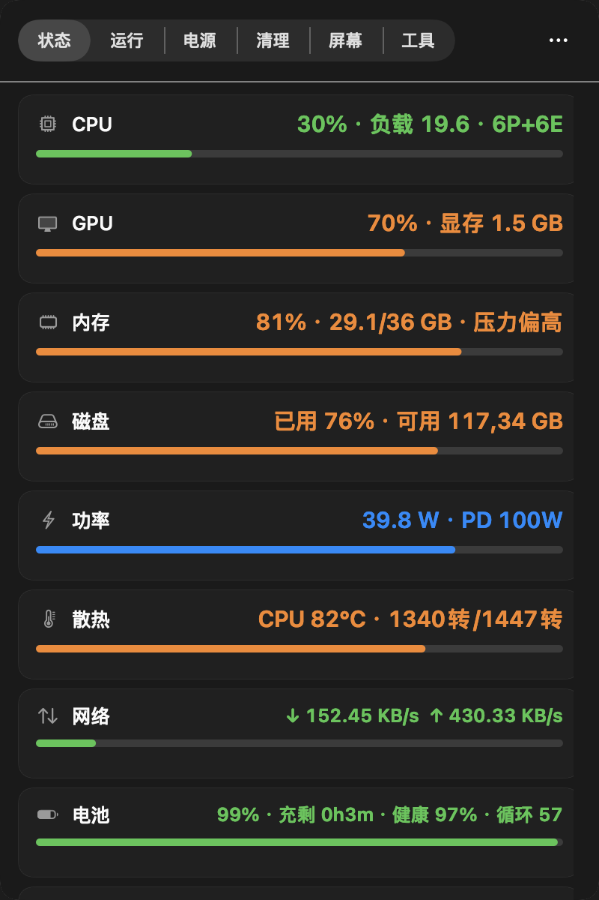 | 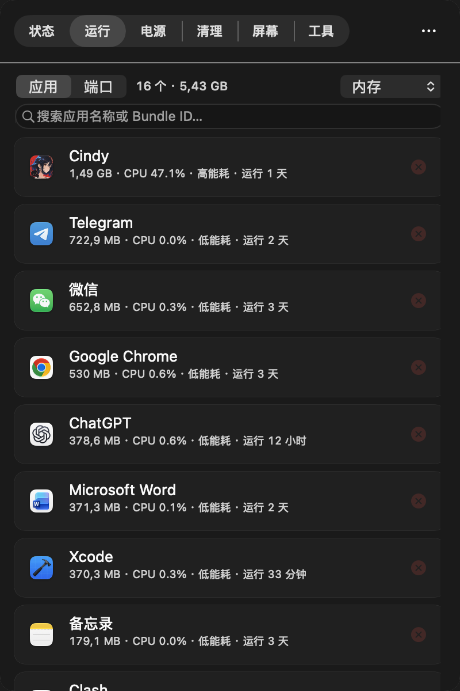 |
| **运行管理 · 端口守卫** | **电源流向与外设电量** |
| 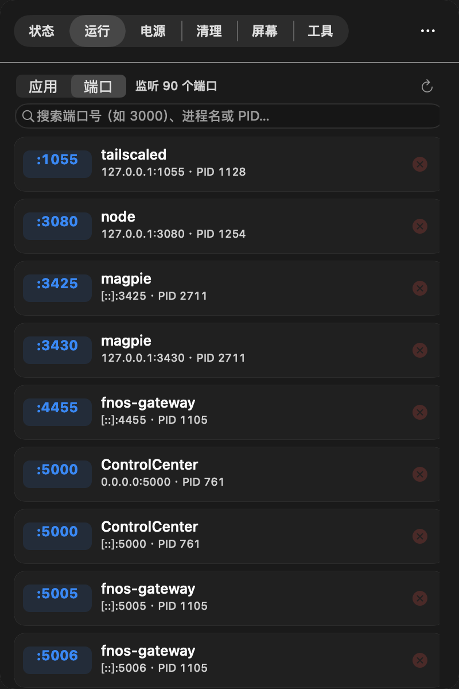 | 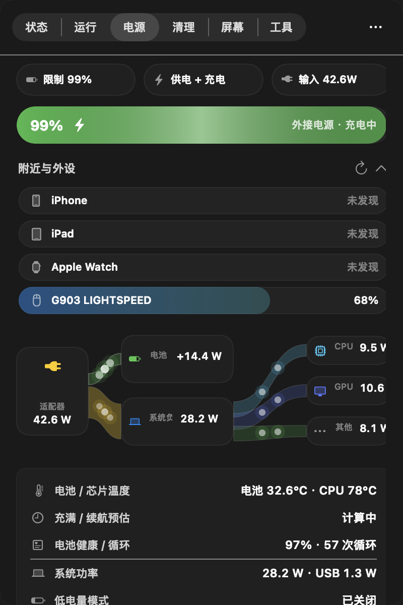 |
| **清理中心 · 四维内存透视** | **清理中心 · 磁盘缓存清理** |
| 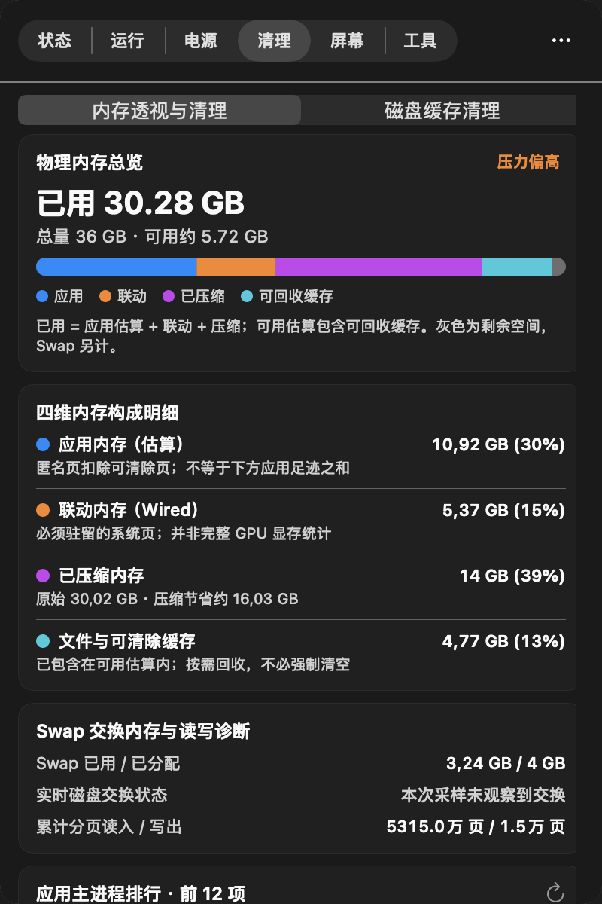 | 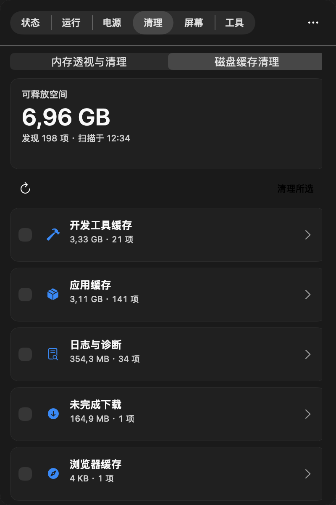 |
| **屏幕控制台（DDC 与布局保护）** | **快捷工具箱（一屏三卡）** |
| 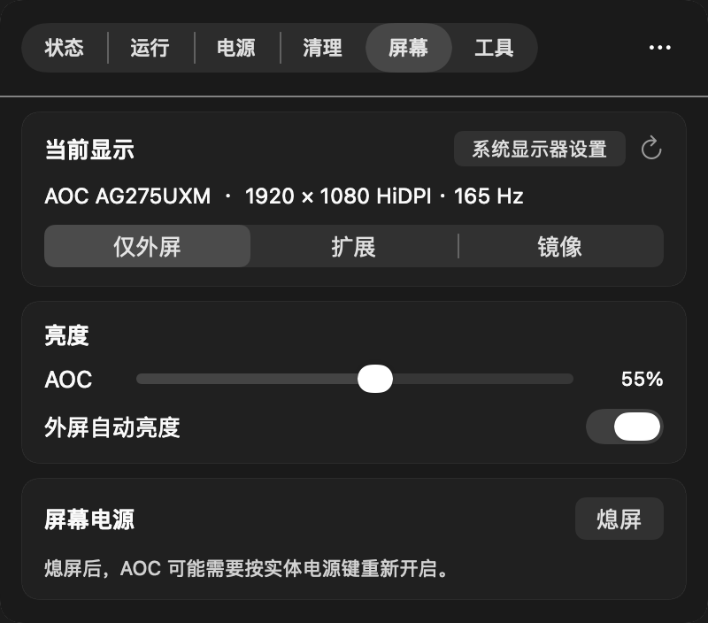 | 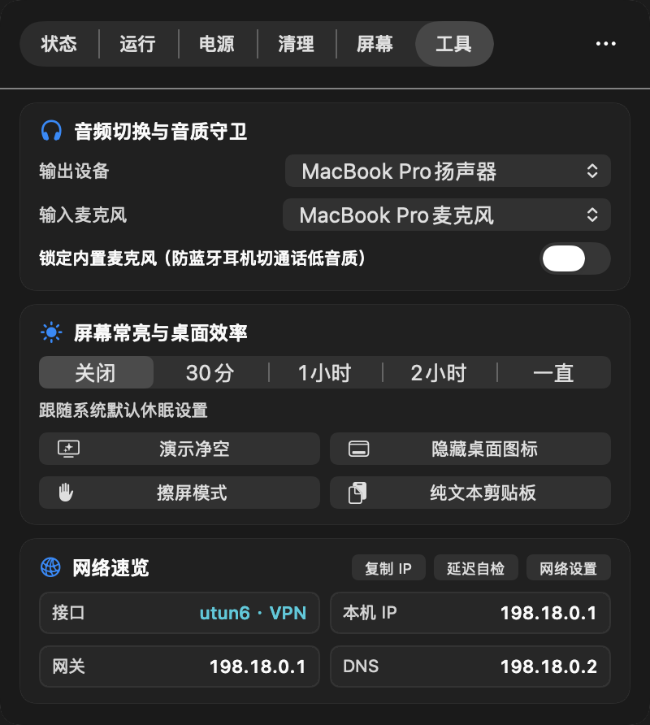 |

### 偏好设置窗口

| 通用设置 | 菜单栏显示配置 | 关于 |
| :---: | :---: | :---: |
| 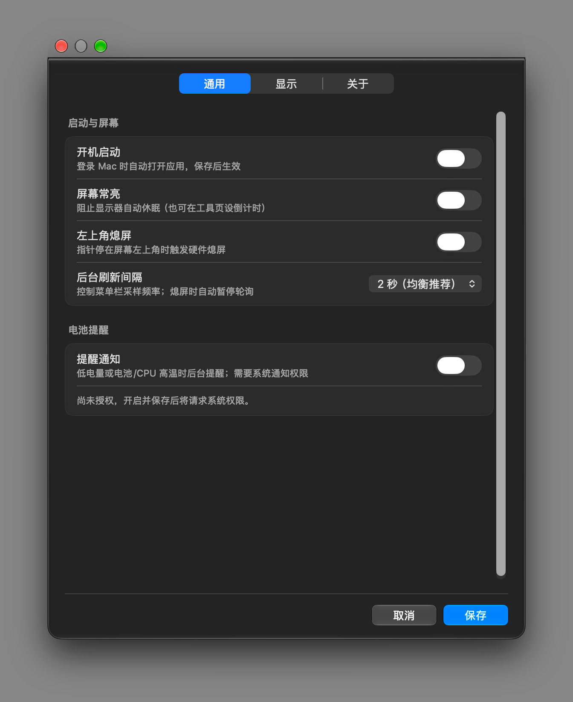 | 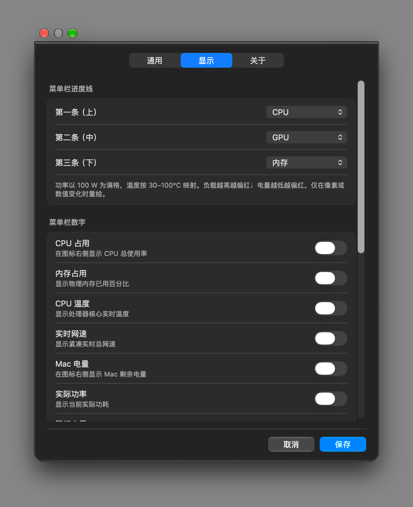 | 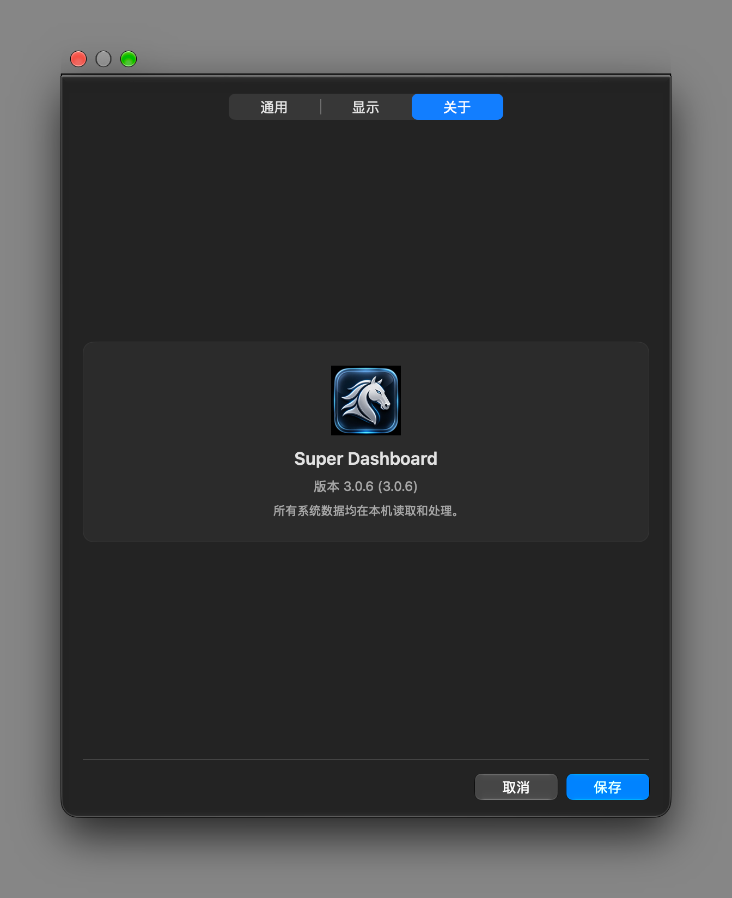 |

## 环境要求

- **运行成品**：Apple Silicon（arm64）Mac，macOS 14 或更高版本；无需另装 Swift、Xcode、Homebrew 或旧显示器控制台。当前不是 Intel / Universal app。
- **从源码构建主程序**：完整 Xcode 与 Swift 6.0 或更新工具链；`xcode-select -p` 应指向所选 Xcode 的 Developer 目录。仅安装 Command Line Tools 不足以运行下面的 Xcode 构建命令。
- **单独编译 helper**：Xcode 或 Command Line Tools；若同时传入已有主程序、资源包及 `--helpers-dir`，打包脚本不会调用编译器。

## 构建与运行

在工程根目录运行；这一步只生成主程序和资源包，显示器 helper 由后面的打包步骤提供：

```bash
xcrun swift build --build-system xcode -c release --product CPAQuotaBar
./Scripts/package-app.sh --skip-build --zip
open "$PWD/dist/Super Dashboard.app"
```

应用启动后驻留菜单栏，没有常驻 Dock 图标；点击菜单栏图标打开仪表盘。
需要直接打开页面或设置时，可在应用完全退出后任选一个启动命令：

```bash
open -a "$PWD/dist/Super Dashboard.app" --args --show --system-status
open -a "$PWD/dist/Super Dashboard.app" --args --settings
```

启动参数在进程启动时读取，已经运行的实例不会重新处理这些参数。
可将完整的 `Super Dashboard.app` 复制到 `/Applications` 后双击启动；不要只复制内部可执行文件。
裸运行 `swift run` 不代表打包后的资源和显示器 helper 已经可用。

## 打包独立 macOS app

打包入口为可执行脚本 `Scripts/package-app.sh`，产物名称为 **Super Dashboard.app**，
版本 **3.0.6**；保留 bundle id `com.local.CPAQuotaBar` 与可执行名 `CPAQuotaBar`。
显示器热插拔防黑屏体系与隔离安全回归见 [DISPLAY_SAFETY_FIX.md](DISPLAY_SAFETY_FIX.md)。
当前打包目标为 Apple Silicon（arm64）、macOS 14+；默认主程序构建需要完整 Xcode。

在工程目录运行：

```bash
# 常规使用：使用 SwiftPM 的 Xcode 构建系统构建 release，默认输出到 dist/
./Scripts/package-app.sh --zip

# 已有 release：不调用 SwiftPM，适合主代理正在构建或测试时使用
./Scripts/package-app.sh --skip-build --output-dir /tmp/super-dashboard-dist --zip

# 指定已有二进制；隐含 --skip-build，默认取二进制旁边的同名 resource bundle
./Scripts/package-app.sh --binary .build/release/CPAQuotaBar \
  --resource-bundle .build/release/CPAQuotaBar_CPAQuotaBar.bundle \
  --output-dir /tmp/super-dashboard-prebuilt --zip

# 复用本脚本已编译的四个 helper，不再调用编译器
./Scripts/package-app.sh --skip-build \
  --helpers-dir '/tmp/super-dashboard-dist/Super Dashboard.app/Contents/MacOS' \
  --output-dir /tmp/super-dashboard-repack

./Scripts/package-app.sh --help
```

`--configuration debug` 可选择已有 debug 构建；`--skip-build` 只跳过主工程构建，
默认仍以独立临时 module cache 编译 helper，不占用 `.build` 或 SwiftPM 构建锁。
`--helpers-dir` 必须包含基于本工程源码重编译的四个 helper，旧安装目录的二进制仍含旧路径，不能直接使用。
输出目录参数相对当前工作目录解析；不传时固定为工程的 `dist/`。
脚本拒绝覆盖已有同名 app/ZIP，失败时清理本次临时目录，不安装、不启动程序、不创建 LaunchAgent。

SwiftPM resource bundle 原样放在 `Contents/Resources/CPAQuotaBar_CPAQuotaBar.bundle`，
与 Xcode 构建系统生成的 `Bundle.module` 查找规则一致；app 根目录只保留 `Contents`。
原生命令行 SwiftPM 的部分工具链只查 app 根目录和构建机绝对路径，这类二进制会被脚本拒绝，
需要先用 `swift build --build-system xcode -c release` 重建；脚本不会修改主源码或二进制内的资源路径。
图标额外复制至 `Contents/Resources/MaShiDashboard.icns`。
请使用与二进制同一次构建的资源包；脚本不会从源码拼凑缺失资源。

四个显示器 helper 安装在包内 `Contents/MacOS`。所有嵌套 Mach-O 文件（包括资源包里的
手机工具和 dylib）逐个 ad-hoc 签名、验证，然后签资源 bundle（有 Info.plist 时）和整个 app。
脚本校验 arm64 架构、非系统绝对动态库依赖、plist 与完整包签名；不使用 `--deep` 进行签名。
签名前会移除包内 Mach-O 中匹配 Xcode / Command Line Tools 安装路径的 `LC_RPATH`，具体范围见历史预检记录。
可选 ZIP 会保留 app 目录结构，并输出 SHA-256。
这是本地 ad-hoc 签名产物，没有 Developer ID 公证。
签名完整性检查通过不等于 Gatekeeper 分发评估通过，也不代表已在 macOS 14 真机验证全部功能。

不启动 app 的复核命令：

```bash
plutil -lint '/tmp/super-dashboard-dist/Super Dashboard.app/Contents/Info.plist'
codesign --verify --deep --strict --verbose=2 '/tmp/super-dashboard-dist/Super Dashboard.app'
test -d '/tmp/super-dashboard-dist/Super Dashboard.app/Contents/Resources/CPAQuotaBar_CPAQuotaBar.bundle'
```

### Helper 范围与限制

| Helper | 包含能力与保留的保护 | 当前限制 |
| --- | --- | --- |
| `DDCControl` | VCP 状态/能力读取、受限写入、校验和、重试、非中断性写入读回、休眠拒绝 | 按名称包含 AG275UXM、序列号 1010101 或厂商号 0x05E3 匹配 AOC 显示器；保留已有白名单；输入源、电源及重置操作跳过即时读回，发送成功不等于读回验证成功 |
| `DisplayManager` | 布局、模式、预设、确认与回退、内屏恢复 | 按序列号 1010101 或厂商号 0x05E3 匹配 AOC。切换前记录实际布局，15 秒内可确认，超时由原生进程还原。使用 SkyLight 私有 API。 |
| `ScreenBlank` | 保存并恢复内屏和键盘背光、互斥锁、恢复快捷键、信号恢复、外屏重新连接恢复 | 硬件关屏绑定上述外屏；不支持的外屏会拒绝执行；外屏可能必须按物理电源键恢复 |
| `builtin_brightness` | 内屏 `get` / `set 0…1`，保留限幅与原退出码 | 使用 DisplayServices 私有 API，只是手动亮度 fallback，不含环境光自动亮度服务 |

helper 间调用已改为自身可执行目录，运行时不依赖旧 app 或 `~/Library/Scripts/builtin_brightness`。
原 `~/Library/Application Support/DisplayPanel/` 状态、锁和恢复文件路径保留，以保持恢复协议一致。
主程序的内屏亮度 fallback 优先使用包内 `builtin_brightness`；旧进程接管与退出时恢复由主程序 lifecycle 处理。
源码来源、依赖与无屏幕写入的自检见 `Helpers/README.md`。
私有显示 API 的存在与行为取决于系统版本和硬件；helper 的策略自检不能验证实际关屏、
拔线重连或恢复效果。不要无参数运行 `ScreenBlank` 来检查安装，它的默认操作是硬件关屏。

### 原生环境光自动亮度

`AutoBrightnessController` 在主程序运行且功能开启时，每 45 秒通过系统 `ioreg` 读取
`CurrentLux`，再调用包内 `DDCControl` 调整受支持外屏的亮度；不依赖旧 als 脚本、
Homebrew 或单独的自动亮度守护程序。只有系统公开有效 `CurrentLux`、且外屏及其连接支持当前
DDC helper 时才可用。无法读到有效环境光时会显示不可用状态，不宣称所有 Mac 都支持。
屏幕休眠或处于硬件关屏状态时暂停调节，较小的目标亮度变化不会重复写入。

保留旧 `~/Library/Application Support/als-auto-brightness/` 下的
`paused_until`（暂停时间戳）和 `last_target`（上次目标亮度）读写兼容；
保留目录名是为了沿用已有状态，不代表仍需要旧脚本。开关状态同时保存在应用偏好中。

### 打包后的自检与页面截图

主程序提供 `--self-check` 只读检查，输出 JSON 报告；必要组件或资源检查失败时退出码为 1，
当前硬件不提供的可选能力标为 `unavailable`。检查会读取系统、显示器和外设状态，
不会调整亮度、切换显示布局、关屏或结束其他进程。

`--quit-self-check` 使用真实的 `NSApplication.run()` 事件循环和 `AppDelegate` 退出处理，
但注入假桌面可见状态与假的常亮计数器。它在异步激活演示模式时连续请求两次退出，
验证退出被暂缓、异步还原完成后才终止；终止通知中输出 JSON，检查模拟写入为 `[false, true]`、
桌面恢复可见、常亮计数归零，且演示模式及切换状态均已清除；检查失败时退出码为 1。
这不会更改真实桌面、建立系统常亮断言或写入显示器，也不代表真实桌面或硬件恢复已经验证。

```bash
'dist/Super Dashboard.app/Contents/MacOS/CPAQuotaBar' --self-check
'dist/Super Dashboard.app/Contents/MacOS/CPAQuotaBar' --quit-self-check

SUPER_DASHBOARD_CAPTURE_DIR="$PWD/dist/captures/displays" \
  SUPER_DASHBOARD_CAPTURE_APPEARANCE=dark \
  SUPER_DASHBOARD_CAPTURE_DELAY=5 \
  'dist/Super Dashboard.app/Contents/MacOS/CPAQuotaBar' \
  --show --displays --quit-after-capture
```

截图需在图形桌面会话中执行。设置 `SUPER_DASHBOARD_CAPTURE_DIR` 后，指定页面只在离屏窗口中布局，
不弹出窗口、不抢焦点，也不安装面板的鼠标或键盘事件监听；截图来自视图渲染，而非桌面截屏。
输出为 `page-<编号>-viewport.png` 和 `page-<编号>-content.png`，上述命令通过
`--quit-after-capture` 在截图尝试后退出。截图模式跳过常规后台启动，所选页面仍会刷新自身数据。

- `SUPER_DASHBOARD_CAPTURE_APPEARANCE=dark` / `light`：仅在设置截图目录时覆盖应用外观，不修改系统主题；未设置或值不匹配时不覆盖。
- `SUPER_DASHBOARD_CAPTURE_DELAY`：选择页面后到截图的等待秒数，默认 5 秒；无法解析时使用默认值，数值限制在 1–60 秒。

可将 `--displays` 换为 `--system-status`、`--power-flow`、`--storage-cleanup`、`--disk-cleanup`、
`--toolbox`、`--running-apps` 或 `--ports`，使用不同输出目录保留各页截图。
这些主程序检查与截图需在最终构建打包后单独执行，打包脚本不会自动启动它们。

### 构建产物说明与限制

- **架构与系统下限**：主程序与四个显示器 helper 均为单架构 `arm64`，最低系统版本 `macOS 14.0`；包内资源用于读取已配对 iOS / watchOS 设备的命令行组件及动态库仅使用包内相对依赖，不依赖外部 Homebrew 或非系统绝对路径。
- **RPATH 清理与签名**：`Scripts/package-app.sh` 会在签名前自动移除包内 Mach-O 中匹配 `/Applications/Xcode*.app/Contents/Developer/*` 或 `/Library/Developer/CommandLineTools/*` 的工具链 `LC_RPATH`，随后逐个对嵌套 Mach-O、资源包与外层 `.app` 执行严格 ad-hoc 签名与校验。首次从 GitHub Release 下载运行如遇 Gatekeeper 提示，可在「系统设置 → 隐私与安全性」中允许打开。
- **第三方二进制声明说明**：随包附带 `m1ddc` MIT、`LGPL-2.1` 及 OpenSSL `Apache-2.0` 许可证文本（位于 `Contents/Resources/Licenses`）；关于 `libimobiledevice` 预编译二进制快照的许可文本说明与上游来源范围，详见 [THIRD_PARTY_NOTICES.md](THIRD_PARTY_NOTICES.md)。

## 测试

```bash
swift test
```

### AppKit 设置页回归测试（Command Line Tools 6.4）

```bash
./Scripts/test-appkit.sh
```

此工具链的默认测试入口缺少 Testing 运行库搜索路径，且初始化 AppKit 后异步测试可能提前结束。
脚本仅在构建目录链接已安装的测试运行库，并以完整 AppKit 事件循环运行测试；无需修改系统配置。
设置测试使用独立偏好域和权限替身，不修改真实登录项、不申请通知权限。
以最后出现的 `Test run with … tests … passed` 为完成依据，不能只看退出码。

### 设置窗口预览

使用 `--settings` 打开设置窗口。可按需给进程设置以下环境变量（不修改系统主题）：

- `SETTINGS_PREVIEW_APPEARANCE=NSAppearanceNameDarkAqua`：深色预览。
- `SETTINGS_PREVIEW_SMALL=1`：以最小允许尺寸打开。
- `SETTINGS_CAPTURE_SEGMENT=0/1/2`：通用、显示、关于。

## 权限说明

菜单栏弹窗提供“路由”和“用量”两个服务器页面，沿用 Magpie 网站原有界面。
查看这两页时弹窗自动加宽并限制在屏幕内，切回本机页面后恢复紧凑尺寸。
服务器登录使用现有网页登录密钥，保存在系统钥匙串；关闭弹窗后停止网页轮询。

- 读取附近 Apple 设备电量需要设备已在本机完成配对，并授予本地网络访问权限。
- 清理功能只针对当前用户可访问的缓存目录，并优先跳过正在运行的应用，降低误清理风险。

## 许可

本项目包含第三方组件与参考项目声明，详见 [THIRD_PARTY_NOTICES.md](THIRD_PARTY_NOTICES.md)。
helper 来源与随包许可证位置见 [Helpers/README.md](Helpers/README.md)。
